# Model evaluation in experimental plots

## Introduction

This document presents **medfate** (**ver. 5.2.1**) model evaluation
results at stand-level, using data from a set of **7 experimental forest
plots**. The main source of observed data are SAPFLUXNET database
([Poyatos et
al. 2021](https://essd.copernicus.org/articles/13/2607/2021/)) and
FLUXNET 2015 dataset ([Pastorello et
al. 2020](https://doi.org/10.1038/s41597-020-0534-3)).

### List of sites

The table below lists the experimental forest plots used in the report
and the data sources available.

| Country | Plot | Stand | SAPFLUXNET | FLUXNET/ICOS |
|:---|:---|:---|:---|:---|
| Australia | Wombat | Mixed eucalyptus forest | AUS_WOM | AU-Wom |
| France | Puéchabon | Dense evergreen forest dominated by Q. ilex | FRA_PUE | FR-Pue |
| France | Hesse | Naturally regenerated, managed beech forest | FRA_HES_HE2_NON | FR-Hes |
| France | Font-Blanche | Mixed forest with P. halepensis and Q. ilex |  | FR-Fbn |
| Israel | Yatir | Pinus halepensis managed plantation | ISR_YAT_YAT | IL-Yat |
| Portugal | Mitra II | Evergreen forest dominated by Quercus ilex subsp. rotundifolia | PRT_MIT | PT-Mi1 |
| Spain | Prades (Tillar valley) | Mixed forest with P. sylvestris (overstory) Q. ilex (midstory) | ESP_TIL_MIX |  |

### Parametrization and simulations

Forest water balance simulations (i.e. function
[`spwb()`](https://emf-creaf.github.io/medfate/reference/spwb.md)) have
been conducted using the three transpiration modes (i.e. `Granier`,
`Sperry` or `Sureau`).

The set of control parameters modified from defaults in simulations are
the following:

| transpirationMode | soilDomains | rhizosphereOverlap | stemCavitationRecovery | leafCavitationRecovery | subdailyResults | verbose | segmentedXylemVulnerability |
|:---|:---|:---|:---|:---|:---|:---|:---|
| Granier | dual | partial | rate | total | FALSE | FALSE | NA |
| Sperry | dual | partial | rate | total | FALSE | FALSE | TRUE |
| Sureau | dual | partial | rate | rate | FALSE | FALSE | FALSE |

Soil characteristics have been tuned to modulate total available water
and fit observed saturation and residual moisture values, but
calibration exercises have not been conducted. When available, however,
local leaf area to sapwood area ratios have been used. Thus, the
evaluation exercise is meant to be more or less representative of
simulations with default species-level trait data.

### Evaluation variables

The table below lists the set of predicted variables that are evaluated
and the data sources used:

| Variable | Level | Observation source | Units |
|----|----|----|----|
| Sensible heat turbulent flux | Stand | FLUXNET / ICOS | MJ/m2 |
| Latent heat turbulent flux | Stand | FLUXNET / ICOS | MJ/m2 |
| Gross primary productivity | Stand | FLUXNET / ICOS | gC/m2 |
| Soil moisture content (topsoil) | Stand | SAPFLUXNET / FLUXNET / ICOS | % vol. |
| Transpiration per leaf area | Plant | SAPFLUXNET | l/m2 |
| Predawn/midday leaf water potential | Plant | SAPFLUXNET (addition) | MPa |

### Structure of site reports

The following contains as many sections as forest stands included in the
evaluation. The following sub-sections are reported for each stand:

1.  **General information**: General information about the site,
    topography, soil and climate, as well as data sources used.
2.  **Model inputs**: Description of model inputs (vegetation, soil,
    custom species parameters and parameterization remarks).
3.  **Climate**: Graphical description of climate inputs and predicted
    soil/canopy temperatures (under Sperry).
4.  **Evaluation results**: Evaluation results are presented for
    variables with available measurements.

## Wombat

### General information

| Attribute | Value |
|:---|:---|
| Plot name | Wombat |
| Country | Australia |
| SAPFLUXNET code | AUS_WOM |
| SAPFLUXNET contributor (affiliation) | Anne Griebel (U. of Melbourne) |
| FLUXNET/ICOS code | AU-Wom |
| FLUXNET/ICOS contributor (affiliation) | Stefan Arndt (U. of Melbourne) |
| Latitude (º) | -37.4222 |
| Longitude (º) | 144.0944 |
| Elevation (m) | 705 |
| Slope (º) | 0 |
| Aspect (º) | 0 |
| Parent material |  |
| Soil texture | Loam |
| MAT (ºC) | 10.9 |
| MAP (mm) | 1024 |
| Forest stand | Mixed eucalyptus forest |
| Stand LAI | 2.2 |
| Stand description DOI | 10.1016/j.foreco.2016.12.017 |
| Species simulated | Eucalyptus obliqua, E. radiata, E. rubida |
| Species parameter table | SpParamsAU |
| Simulation period | 2013-2015 |
| Evaluation period | 2013-2015 |

### Model inputs

#### Vegetation

| Species            | DBH | Height |      N | Z50 |  Z95 |   LAI |
|:-------------------|----:|-------:|-------:|----:|-----:|------:|
| Eucalyptus obliqua |  23 |   2200 | 712.60 | 300 | 1000 | 1.540 |
| Eucalyptus rubida  |  23 |   2200 | 213.78 | 300 | 1000 | 0.462 |
| Eucalyptus radiata |  23 |   2200 |  91.62 | 300 | 1000 | 0.198 |

#### Soil

| widths |  clay |     sand |    om |        bd |   rfc |
|-------:|------:|---------:|------:|----------:|------:|
|    100 | 24.30 | 55.13333 | 8.340 | 0.9866667 | 13.60 |
|    200 | 25.00 | 50.00000 | 6.000 | 1.1000000 | 14.00 |
|    700 | 35.25 | 44.60000 | 4.465 | 1.2100000 | 14.35 |
|   1000 | 33.10 | 45.90000 | 4.160 | 1.2800000 | 50.00 |
|   2000 | 33.10 | 45.90000 | 0.000 | 1.3500000 | 90.00 |

#### Custom traits

| Species            |    Al2As |
|:-------------------|---------:|
| Eucalyptus obliqua | 4869.026 |
| Eucalyptus rubida  | 4869.026 |
| Eucalyptus radiata | 4869.026 |

#### Custom control

||
||
||

#### Remarks

| Title           | Remark                                         |
|:----------------|:-----------------------------------------------|
| Soil            | Taken from SoilGrids                           |
| Vegetation      | No understory or secondary species considered. |
| Weather         |                                                |
| Sapflow         | Species-level Huber value used for scaling     |
| Eddy covariance | Variables taken: LE_CORR and GPP_NT_VUT_REF    |

### Macroclimate

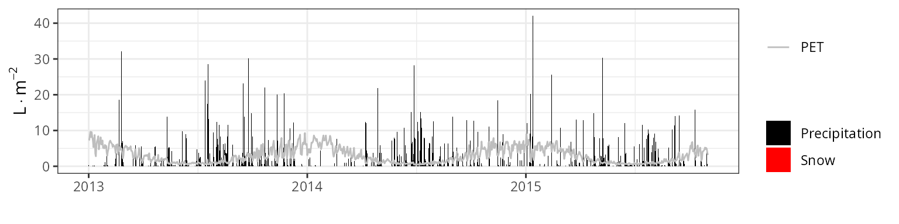

### Microclimate

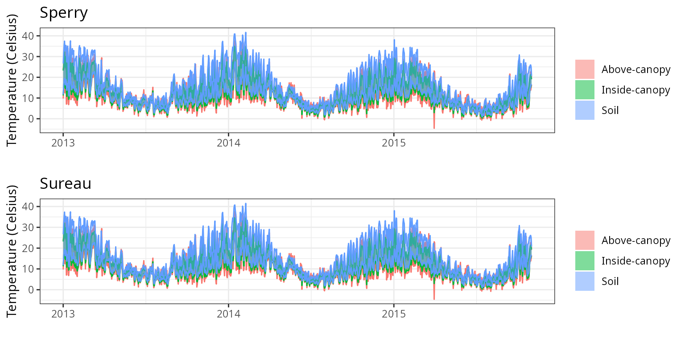

### Runoff & deep drainage

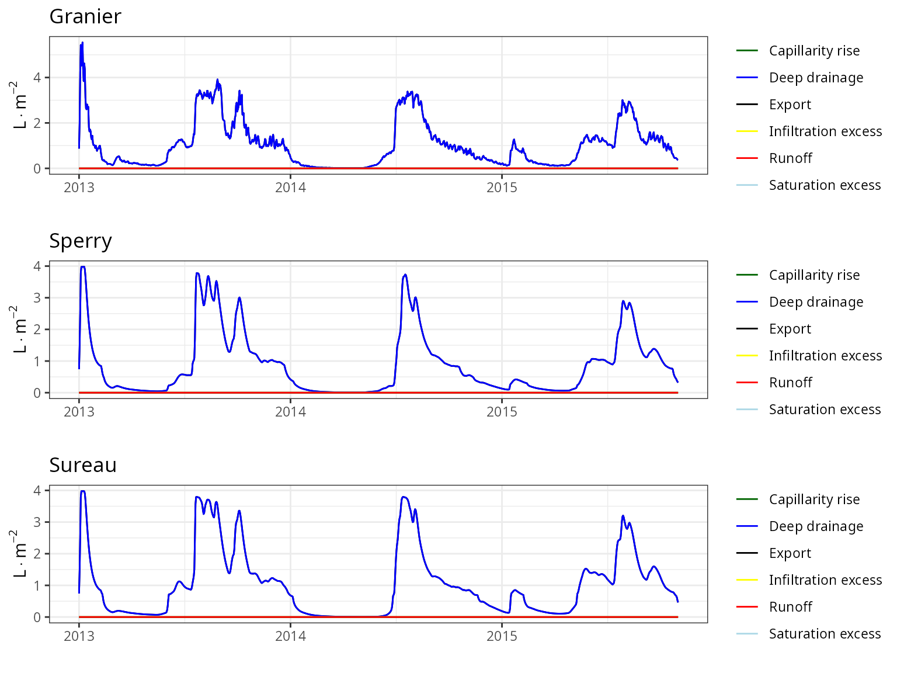

### Evaluation results

#### Sensible heat turbulent flux

| Site | Mode | n | Bias | Bias.rel | MAE | MAE.rel | r | NSE | NSE.abs |
|:---|:---|---:|---:|---:|---:|---:|---:|---:|---:|
| WOMBAT | sperry | 730 | -1.428597 | -41.34084 | 3.939007 | 113.9873 | 0.5214748 | -0.0934866 | 0.0379017 |
| WOMBAT | sureau | 730 | -1.154098 | -33.39737 | 3.859558 | 111.6882 | 0.5272039 | -0.0655767 | 0.0573070 |

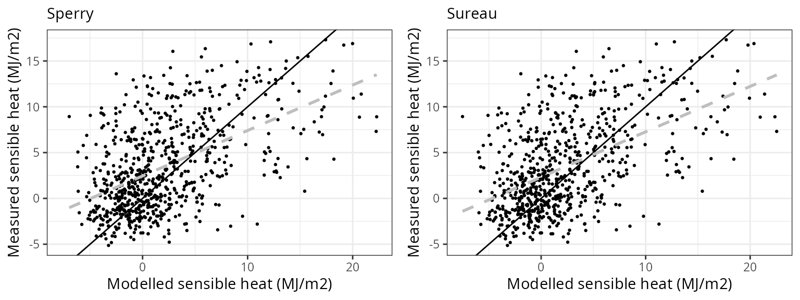

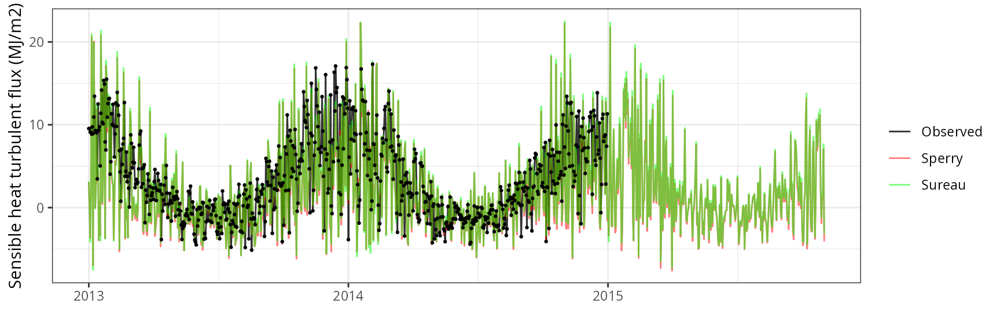

#### Latent heat turbulent flux

| Site | Mode | n | Bias | Bias.rel | MAE | MAE.rel | r | NSE | NSE.abs |
|:---|:---|---:|---:|---:|---:|---:|---:|---:|---:|
| WOMBAT | sperry | 730 | -2.548271 | -44.20023 | 2.776971 | 48.16708 | 0.7273581 | -0.1820938 | -0.1081770 |
| WOMBAT | sureau | 730 | -2.893796 | -50.19343 | 3.098756 | 53.74849 | 0.6982259 | -0.3956881 | -0.2365883 |

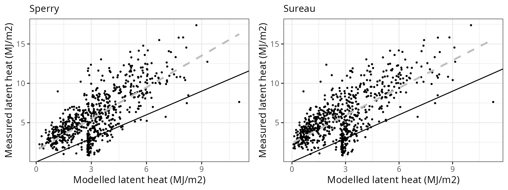

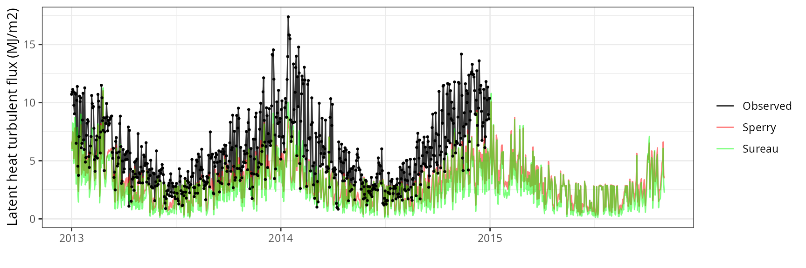

#### Gross primary productivity

| Site | Mode | n | Bias | Bias.rel | MAE | MAE.rel | r | NSE | NSE.abs |
|:---|:---|---:|---:|---:|---:|---:|---:|---:|---:|
| WOMBAT | granier | 730 | -2.3748524 | -43.06430 | 2.457119 | 44.55607 | 0.7457413 | -0.3613175 | -0.1745626 |
| WOMBAT | sperry | 730 | -0.7192459 | -13.04242 | 1.411707 | 25.59914 | 0.7390668 | 0.4528057 | 0.3251696 |
| WOMBAT | sureau | 730 | -0.9227422 | -16.73251 | 1.482332 | 26.87981 | 0.7519281 | 0.4112031 | 0.2914092 |

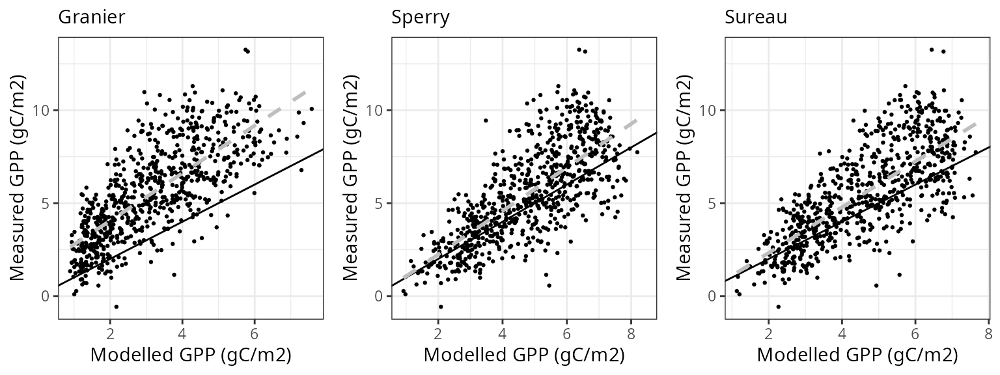

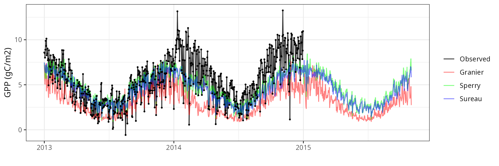

#### Soil water content (SWC.1)

| Site | Mode | n | Bias | Bias.rel | MAE | MAE.rel | r | NSE | NSE.abs |
|:---|:---|---:|---:|---:|---:|---:|---:|---:|---:|
| WOMBAT | granier | 1035 | -0.0597896 | -28.46473 | 0.0729993 | 34.75363 | 0.5339191 | -0.6611362 | -0.4258494 |
| WOMBAT | sperry | 1035 | -0.0652402 | -31.05969 | 0.0755127 | 35.95021 | 0.5878526 | -0.7682443 | -0.4749420 |
| WOMBAT | sureau | 1035 | -0.0622939 | -29.65699 | 0.0739775 | 35.21934 | 0.5504254 | -0.7051228 | -0.4449561 |

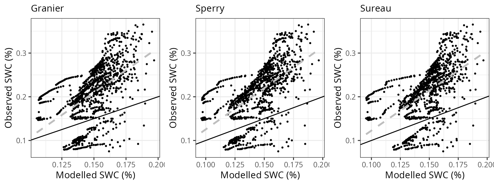

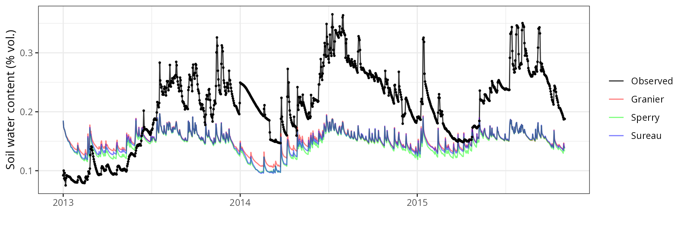

#### Transpiration per leaf area

| Site | Cohort | Mode | n | Bias | Bias.rel | MAE | MAE.rel | r | NSE | NSE.abs |
|:---|:---|:---|---:|---:|---:|---:|---:|---:|---:|---:|
| WOMBAT | T1_7425 | granier | 1035 | -0.1056988 | -27.507763 | 0.1201993 | 31.28146 | 0.9083485 | 0.6208399 | 0.4036119 |
| WOMBAT | T1_7425 | sperry | 1035 | 0.0340388 | 8.858477 | 0.1359142 | 35.37120 | 0.9247038 | 0.3277914 | 0.3256402 |
| WOMBAT | T1_7425 | sureau | 1035 | -0.0924958 | -24.071727 | 0.1460897 | 38.01934 | 0.9072630 | 0.4738413 | 0.2751528 |
| WOMBAT | T2_7520 | granier | 1035 | -0.0796844 | -18.676560 | 0.1189804 | 27.88682 | 0.9024800 | 0.7349296 | 0.5443132 |
| WOMBAT | T2_7520 | sperry | 1035 | -0.1522706 | -35.689436 | 0.1581740 | 37.07310 | 0.9337686 | 0.5582763 | 0.3942041 |
| WOMBAT | T2_7520 | sureau | 1035 | -0.0372981 | -8.741981 | 0.1196180 | 28.03627 | 0.9409981 | 0.7340182 | 0.5418711 |

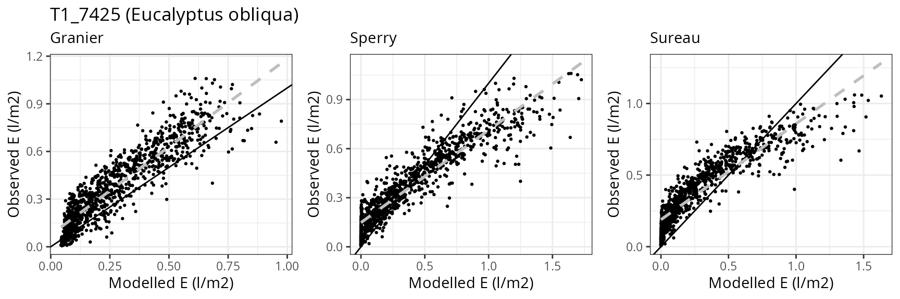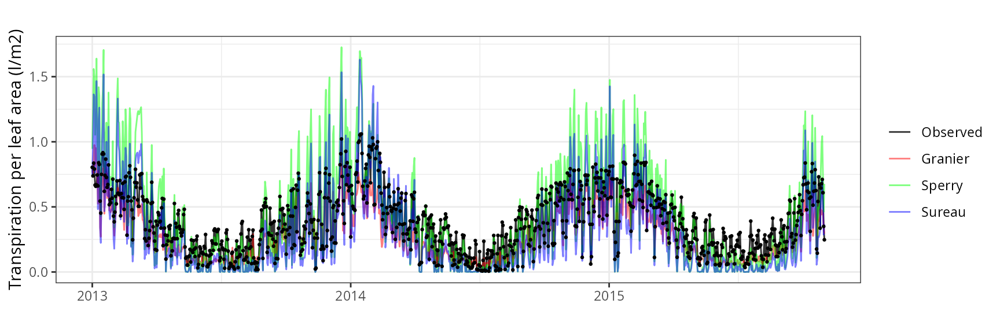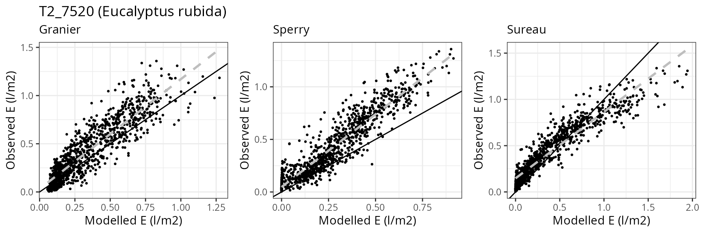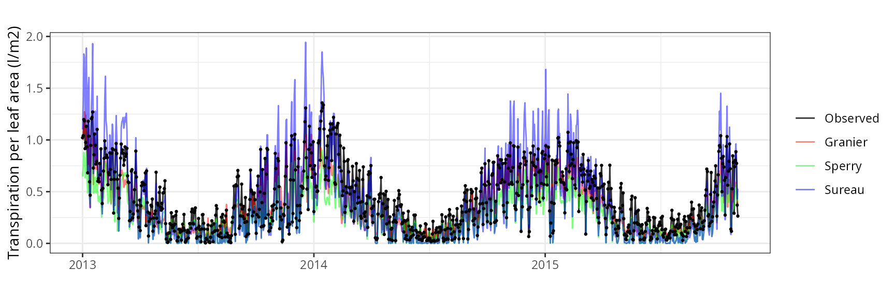

## Puéchabon

### General information

| Attribute | Value |
|:---|:---|
| Plot name | Puéchabon |
| Country | France |
| SAPFLUXNET code | FRA_PUE |
| SAPFLUXNET contributor (affiliation) | Jean-Marc Limousin (CEFE-CNRS) |
| FLUXNET/ICOS code | FR-Pue |
| FLUXNET/ICOS contributor (affiliation) | Jean-Marc Limousin (CEFE-CNRS) |
| Latitude (º) | 43.74 |
| Longitude (º) | 3.6 |
| Elevation (m) | 270 |
| Slope (º) | 0 |
| Aspect (º) | 0 |
| Parent material | Limestone |
| Soil texture | Silty clay loam |
| MAT (ºC) | 13.4 |
| MAP (mm) | 720 |
| Forest stand | Dense evergreen forest dominated by Q. ilex |
| Stand LAI | 2 |
| Stand description DOI | 10.1111/j.1365-2486.2009.01852.x |
| Species simulated | Quercus ilex, Buxus sempervirens |
| Species parameter table | SpParamsFR |
| Simulation period | 2004-2006 |
| Evaluation period | 2004-2006 |

### Model inputs

#### Vegetation

| Species            |    DBH |   Height |    N | Z50 | Z95 | LAI | Cover |
|:-------------------|-------:|---------:|-----:|----:|:----|----:|------:|
| Quercus ilex       | 9.1156 | 530.2222 | 1750 | 300 | NA  | 2.0 |    NA |
| Buxus sempervirens |     NA | 200.0000 |   NA |  NA | NA  | 0.2 |    13 |
| Herbaceous layer   |     NA |  20.0000 |   NA |  NA | NA  |  NA |    10 |

#### Soil

| widths | clay | sand |  om |   bd | rfc | VG_theta_sat | VG_theta_res | VG_n | VG_alpha |     Ksat |
|-------:|-----:|-----:|----:|-----:|----:|-------------:|-------------:|-----:|---------:|---------:|
|    200 |   39 |   26 |   6 | 1.45 |  75 |          0.5 |        0.098 | 1.55 | 5.099887 | 1107.446 |
|    800 |   39 |   26 |   3 | 1.45 |  82 |          0.5 |        0.098 | 1.55 | 5.099887 | 1107.446 |
|   3000 |   39 |   26 |   1 | 1.45 |  93 |          0.5 |        0.098 | 1.55 | 5.099887 | 1107.446 |

#### Custom traits

| Species | Hmax | Hmed | SLA | VCleaf_kmax | Kmax_stemxylem | LeafEPS | LeafPI0 | LeafAF | StemEPS | StemPI0 | StemAF | Al2As |
|:---|---:|---:|---:|---:|---:|---:|---:|---:|---:|---:|---:|---:|
| Quercus ilex | 1240 | 450 | 4.55 | 2.63 | 0.40 | 15 | -2.5 | 0.4 | 15 | -2.5 | 0.4 | 1540.671 |
| Buxus sempervirens | NA | NA | 5.19 | 2.00 | 0.15 | NA | NA | NA | NA | NA | NA | NA |

#### Custom control

||
||
||

#### Remarks

| Title      | Remark                              |
|:-----------|:------------------------------------|
| Soil       | Adjusted theta_res and theta_sat    |
| Vegetation | Using B. sempervirens as understory |

### Macroclimate

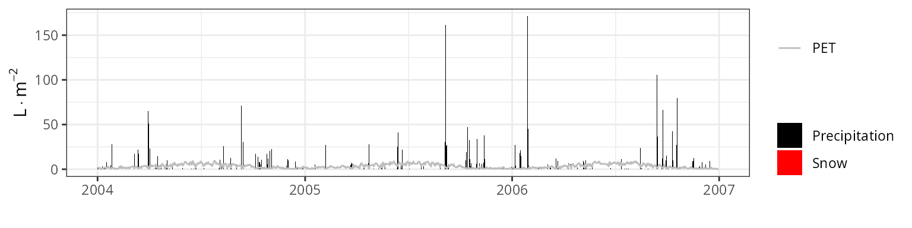

### Microclimate

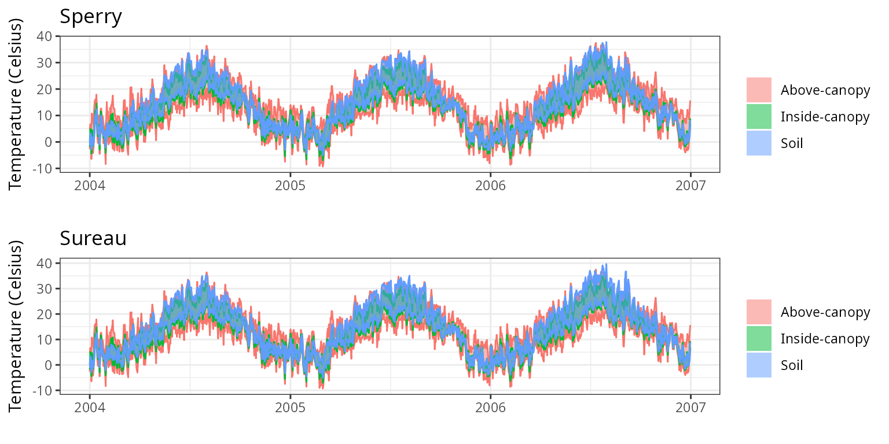

### Runoff & deep drainage

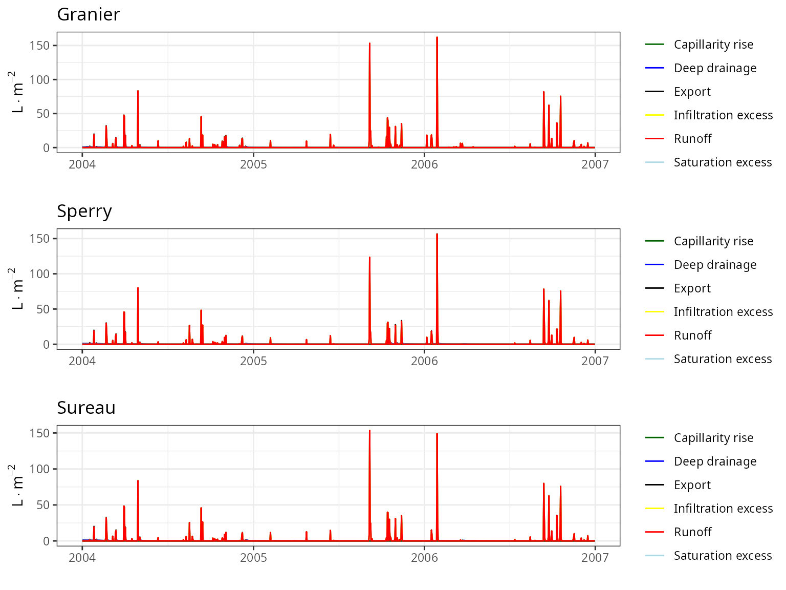

### Evaluation results

#### Sensible heat turbulent flux

| Site | Mode | n | Bias | Bias.rel | MAE | MAE.rel | r | NSE | NSE.abs |
|:---|:---|---:|---:|---:|---:|---:|---:|---:|---:|
| FRAPUE | sperry | 1096 | -2.788454 | -78.77299 | 4.506343 | 127.3029 | 0.5372910 | -0.1300551 | 0.0074406 |
| FRAPUE | sureau | 1096 | -2.476774 | -69.96812 | 4.378719 | 123.6975 | 0.5083781 | -0.0929410 | 0.0355510 |

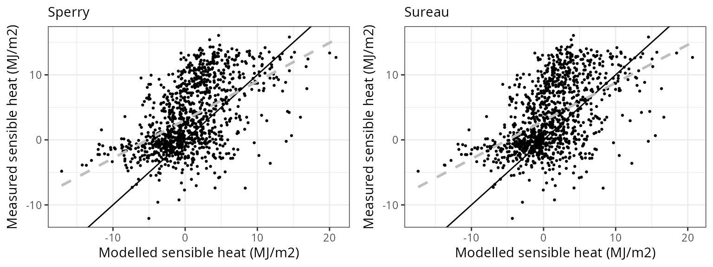

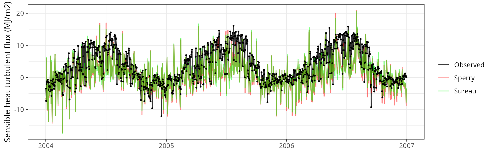

#### Latent heat turbulent flux

| Site | Mode | n | Bias | Bias.rel | MAE | MAE.rel | r | NSE | NSE.abs |
|:---|:---|---:|---:|---:|---:|---:|---:|---:|---:|
| FRAPUE | sperry | 1096 | -0.3664675 | -11.51889 | 1.472239 | 46.27577 | 0.5749652 | 0.283938 | 0.2283197 |
| FRAPUE | sureau | 1096 | -0.6041928 | -18.99113 | 1.493069 | 46.93050 | 0.6221842 | 0.289119 | 0.2174016 |

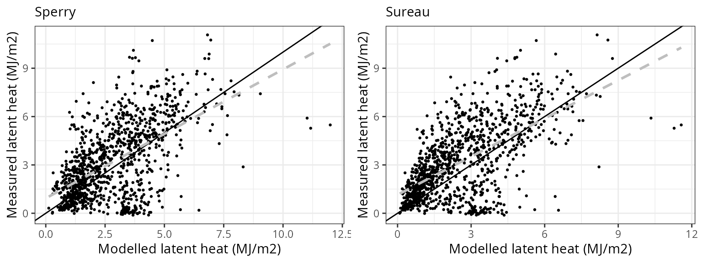

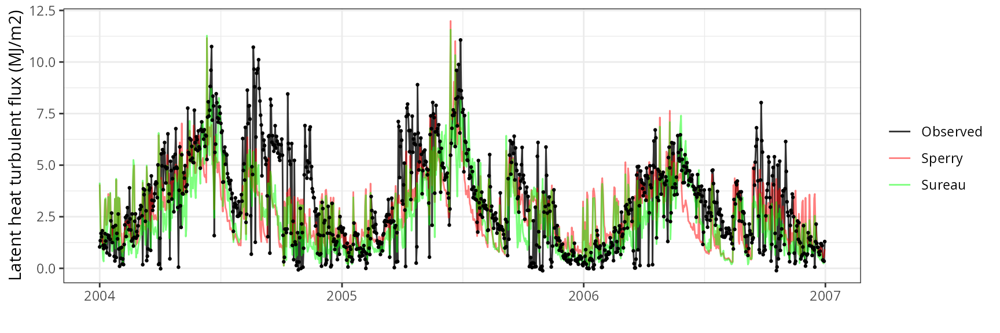

#### Gross primary productivity

| Site | Mode | n | Bias | Bias.rel | MAE | MAE.rel | r | NSE | NSE.abs |
|:---|:---|---:|---:|---:|---:|---:|---:|---:|---:|
| FRAPUE | granier | 1096 | -0.2338209 | -7.0875645 | 1.1177309 | 33.88058 | 0.6984496 | 0.4152787 | 0.2893788 |
| FRAPUE | sperry | 1096 | 0.2610572 | 7.9131482 | 0.8559000 | 25.94398 | 0.8156334 | 0.6317470 | 0.4558434 |
| FRAPUE | sureau | 1096 | -0.0019782 | -0.0599628 | 0.8430483 | 25.55442 | 0.8128794 | 0.6501605 | 0.4640141 |

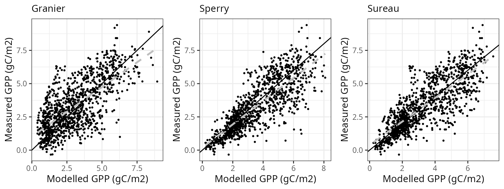

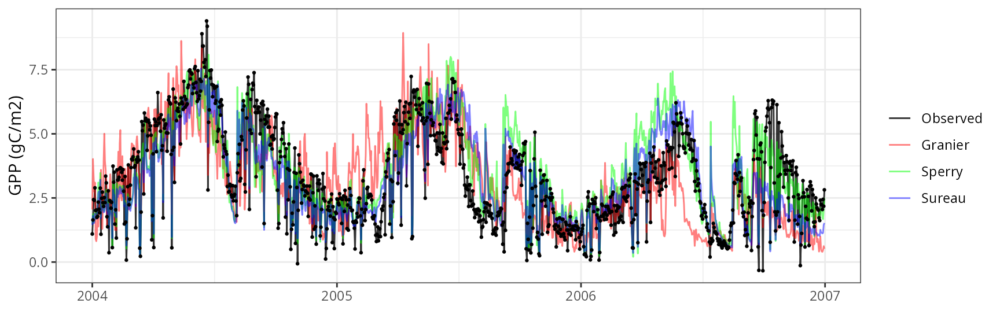

#### Soil water content (SWC.2)

| Site | Mode | n | Bias | Bias.rel | MAE | MAE.rel | r | NSE | NSE.abs |
|:---|:---|---:|---:|---:|---:|---:|---:|---:|---:|
| FRAPUE | granier | 1021 | 0.1203452 | 75.55049 | 0.1309547 | 82.21090 | -0.0636748 | -11.81451 | -2.414055 |
| FRAPUE | sperry | 1021 | 0.1368202 | 85.89316 | 0.1439937 | 90.39657 | 0.5572701 | -11.51199 | -2.753990 |
| FRAPUE | sureau | 1021 | 0.1203675 | 75.56447 | 0.1336028 | 83.87336 | 0.2564172 | -11.20860 | -2.483094 |

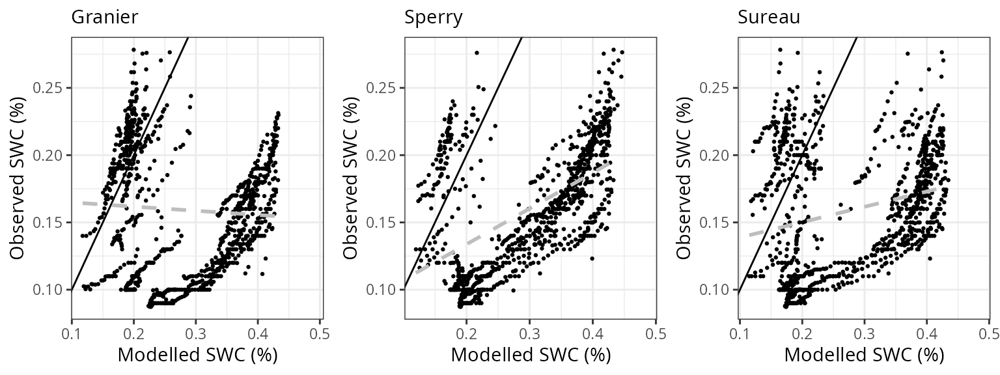

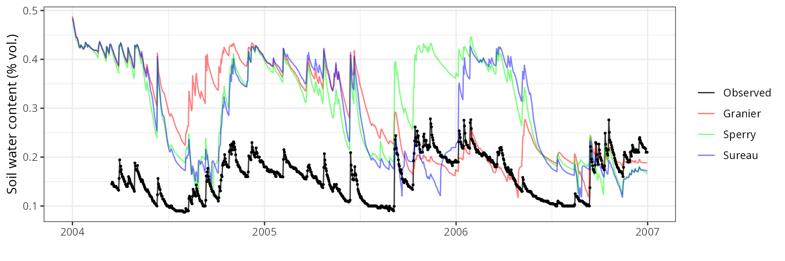

#### Transpiration per leaf area

| Site | Cohort | Mode | n | Bias | Bias.rel | MAE | MAE.rel | r | NSE | NSE.abs |
|:---|:---|:---|---:|---:|---:|---:|---:|---:|---:|---:|
| FRAPUE | T1_2853 | granier | 1096 | -0.0894729 | -26.083081 | 0.1349603 | 39.34352 | 0.7351244 | 0.3533474 | 0.2544205 |
| FRAPUE | T1_2853 | sperry | 1096 | 0.0283133 | 8.253885 | 0.1417679 | 41.32809 | 0.7853223 | 0.2306710 | 0.2168118 |
| FRAPUE | T1_2853 | sureau | 1096 | -0.0123288 | -3.594093 | 0.1472332 | 42.92133 | 0.8185690 | 0.1404498 | 0.1866192 |

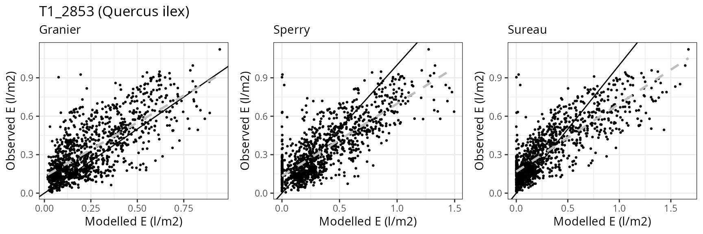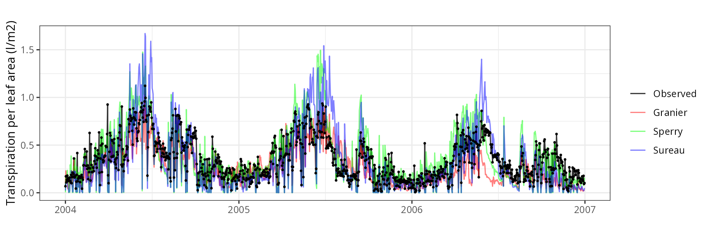

#### Leaf water potential

| Site | Cohort | WP | Mode | n | Bias | Bias.rel | MAE | MAE.rel | r | NSE | NSE.abs |
|:---|:---|:---|:---|---:|---:|---:|---:|---:|---:|---:|---:|
| FRAPUE | T1_2853 | Midday | sperry | 28 | 0.0353417 | 1.132665 | 0.4883659 | 15.65163 | 0.7700777 | 0.2400240 | 0.1819789 |
| FRAPUE | T1_2853 | Midday | sureau | 28 | 0.0390338 | 1.250993 | 0.7853605 | 25.17001 | 0.8077734 | -0.8191437 | -0.3154921 |
| FRAPUE | T1_2853 | Predawn | sperry | 28 | -0.3364556 | -23.001998 | 0.5252864 | 35.91154 | 0.8582439 | 0.6428987 | 0.4475799 |
| FRAPUE | T1_2853 | Predawn | sureau | 28 | -0.5537484 | -37.857360 | 0.7987570 | 54.60753 | 0.8889080 | 0.1231106 | 0.1599832 |

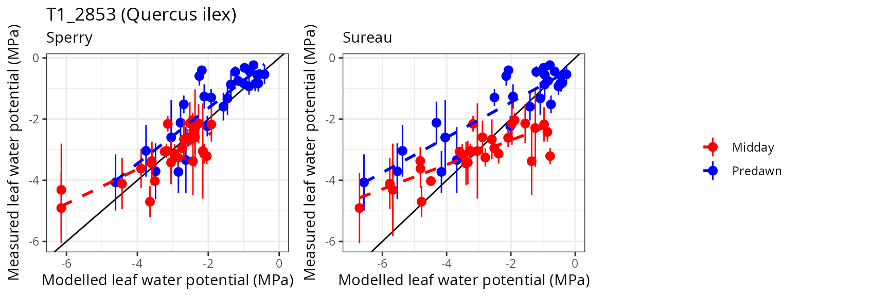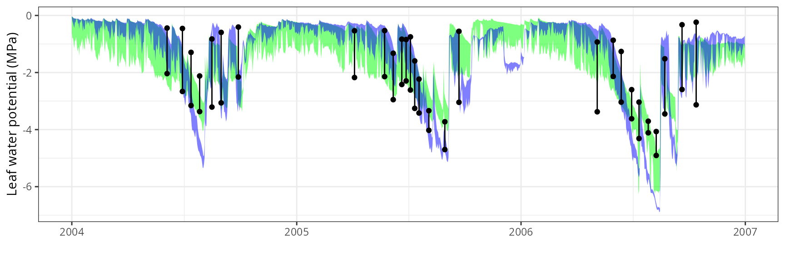

## Hesse

### General information

| Attribute | Value |
|:---|:---|
| Plot name | Hesse |
| Country | France |
| SAPFLUXNET code | FRA_HES_HE2_NON |
| SAPFLUXNET contributor (affiliation) | André Granier (INRAE) |
| FLUXNET/ICOS code | FR-Hes |
| FLUXNET/ICOS contributor (affiliation) | Matthias Cuntz (INRAE) |
| Latitude (º) | 48.6742 |
| Longitude (º) | 7.0647 |
| Elevation (m) | 300 |
| Slope (º) | 0 |
| Aspect (º) | 0 |
| Parent material |  |
| Soil texture | Silt loam |
| MAT (ºC) | 10 |
| MAP (mm) | 1003 |
| Forest stand | Naturally regenerated, managed beech forest |
| Stand LAI | 7 |
| Stand description DOI | 10.1051/forest:2008052 |
| Species simulated | Fagus sylvatica |
| Species parameter table | SpParamsFR |
| Simulation period | 2001-2003 |
| Evaluation period | 2001-2003 |

### Model inputs

#### Vegetation

| Species          |   DBH | Height |    N | Z50 |  Z95 | LAI | Cover |
|:-----------------|------:|-------:|-----:|----:|-----:|----:|------:|
| Fagus sylvatica  | 12.91 |   1300 | 3203 | 300 | 1200 |   7 |    NA |
| Herbaceous layer |    NA |     20 |   NA |  NA |   NA |  NA |     5 |

#### Soil

| widths | sand | clay |  om | rfc |   bd | VG_theta_sat |
|-------:|-----:|-----:|----:|----:|-----:|-------------:|
|    200 |    8 |   25 |   6 |   9 | 1.16 |         0.46 |
|    300 |    8 |   35 |   3 |  13 | 1.37 |         0.43 |
|    300 |    8 |   45 |   1 |  15 | 1.58 |         0.38 |
|    400 |    8 |   45 |   0 |  40 | 1.58 |         0.35 |
|   2100 |    8 |   45 |   0 |  90 | 1.58 |         0.30 |

#### Custom traits

| Species         |   Al2As |
|:----------------|--------:|
| Fagus sylvatica | 2076.12 |

#### Custom control

||
||
||

#### Remarks

| Title      | Remark                                      |
|:-----------|:--------------------------------------------|
| Soil       | VG_theta_sat modified                       |
| Vegetation | No woody understory but 5% herbaceous layer |
| Sapflow    | Scaling using species-level Huber value     |

### Macroclimate

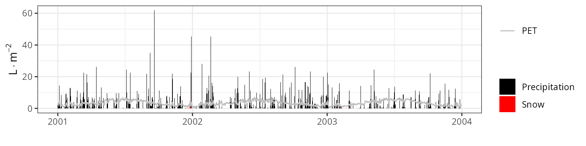

### Microclimate

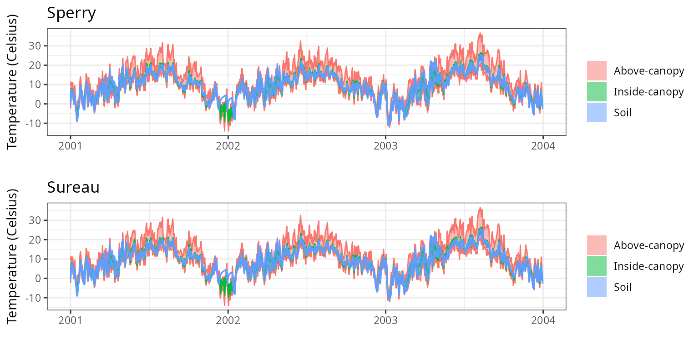

### Runoff & deep drainage

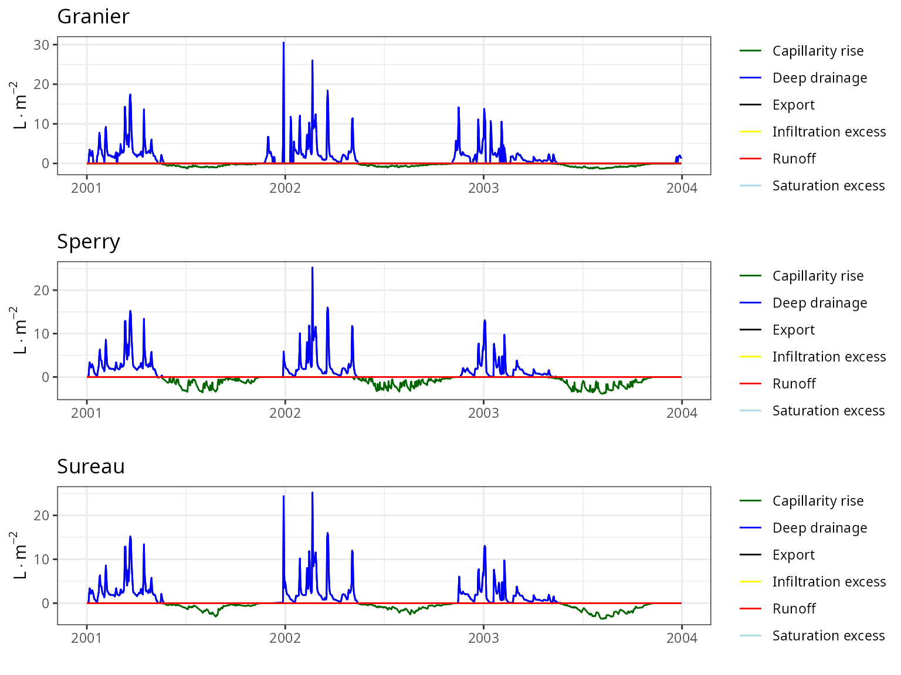

### Evaluation results

#### Sensible heat turbulent flux

| Site | Mode | n | Bias | Bias.rel | MAE | MAE.rel | r | NSE | NSE.abs |
|:---|:---|---:|---:|---:|---:|---:|---:|---:|---:|
| FRAHES | sperry | 1070 | -5.727179 | -390.0932 | 7.017742 | 477.9968 | 0.0350677 | -3.610564 | -1.612985 |
| FRAHES | sureau | 1070 | -5.464969 | -372.2333 | 6.764545 | 460.7509 | 0.0382443 | -3.281673 | -1.518710 |

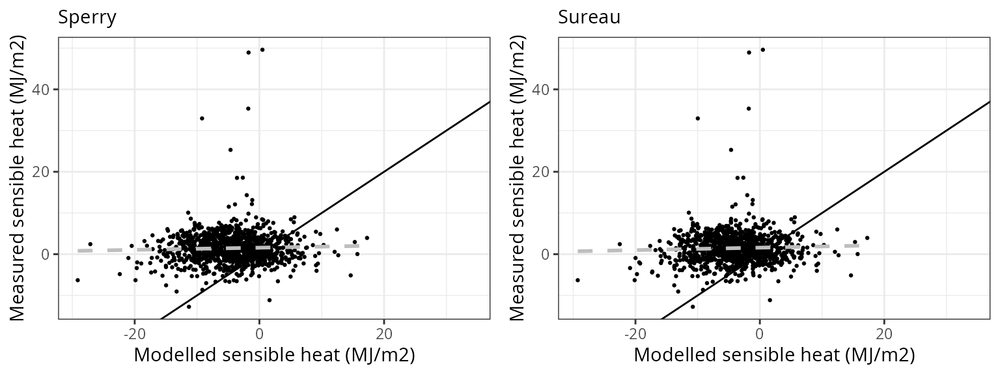

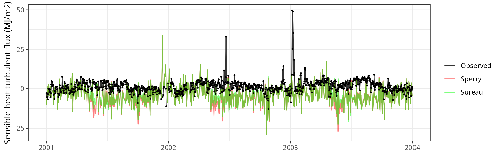

#### Latent heat turbulent flux

| Site | Mode | n | Bias | Bias.rel | MAE | MAE.rel | r | NSE | NSE.abs |
|:---|:---|---:|---:|---:|---:|---:|---:|---:|---:|
| FRAHES | sperry | 1064 | 3.827485 | 161.8593 | 4.274919 | 180.7807 | 0.7301404 | -3.884944 | -0.8881039 |
| FRAHES | sureau | 1064 | 3.130204 | 132.3722 | 3.564672 | 150.7453 | 0.7282712 | -2.227414 | -0.5744092 |

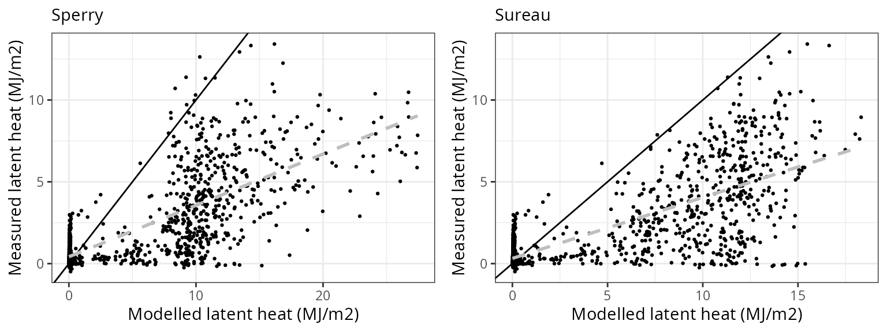

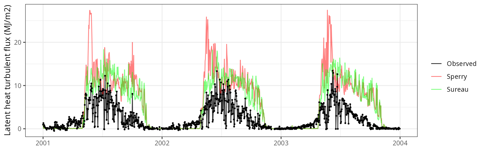

#### Soil water content (SWC.1)

| Site | Mode | n | Bias | Bias.rel | MAE | MAE.rel | r | NSE | NSE.abs |
|:---|:---|---:|---:|---:|---:|---:|---:|---:|---:|
| FRAHES | granier | 43 | -0.0796750 | -24.53607 | 0.0800778 | 24.66010 | 0.9290080 | -0.7511546 | -0.3820104 |
| FRAHES | sperry | 43 | -0.1088291 | -33.51413 | 0.1088291 | 33.51413 | 0.8474224 | -1.9822748 | -0.8782110 |
| FRAHES | sureau | 43 | -0.0950645 | -29.27530 | 0.0950645 | 29.27530 | 0.9009644 | -1.2882299 | -0.6406566 |

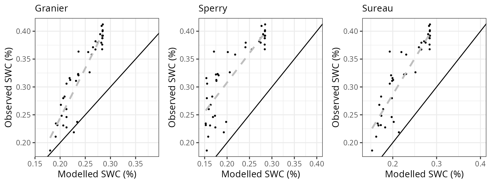

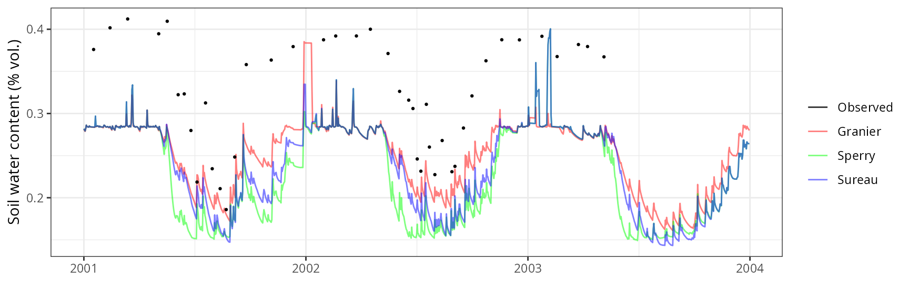

#### Soil water content (SWC.2)

| Site | Mode | n | Bias | Bias.rel | MAE | MAE.rel | r | NSE | NSE.abs |
|:---|:---|---:|---:|---:|---:|---:|---:|---:|---:|
| FRAHES | granier | 43 | -0.0297155 | -8.672327 | 0.0322366 | 9.408076 | 0.9340662 | 0.6221582 | 0.4049036 |
| FRAHES | sperry | 43 | -0.0747924 | -21.827784 | 0.0747931 | 21.827977 | 0.8733004 | -0.9832441 | -0.3807022 |
| FRAHES | sureau | 43 | -0.0522463 | -15.247813 | 0.0522463 | 15.247813 | 0.9379617 | 0.0926402 | 0.0355181 |

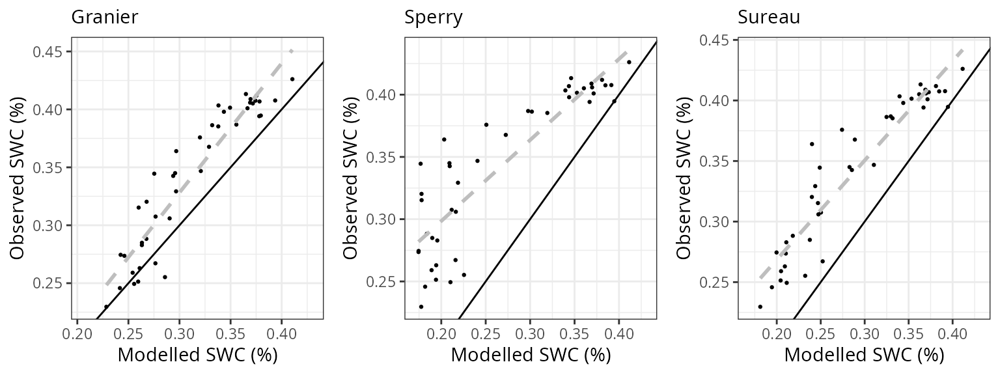

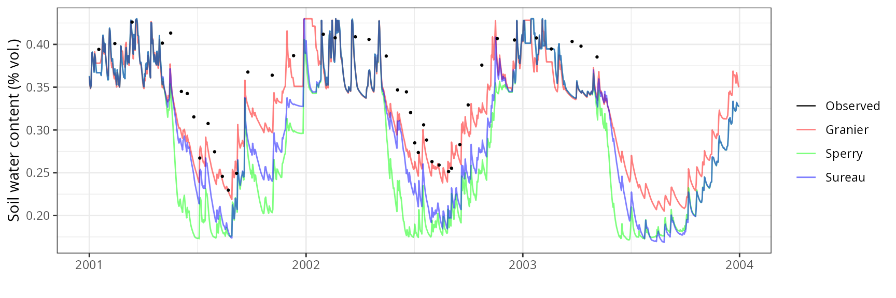

#### Soil water content (SWC.3)

| Site | Mode | n | Bias | Bias.rel | MAE | MAE.rel | r | NSE | NSE.abs |
|:---|:---|---:|---:|---:|---:|---:|---:|---:|---:|
| FRAHES | granier | 43 | -0.0018129 | -0.5408908 | 0.0147495 | 4.400515 | 0.9191030 | 0.6864542 | 0.4803363 |
| FRAHES | sperry | 43 | -0.0644969 | -19.2426400 | 0.0729113 | 21.753072 | 0.8156978 | -7.2070200 | -1.5688545 |
| FRAHES | sureau | 43 | -0.0377715 | -11.2691271 | 0.0468131 | 13.966675 | 0.9475137 | -2.3118763 | -0.6493466 |

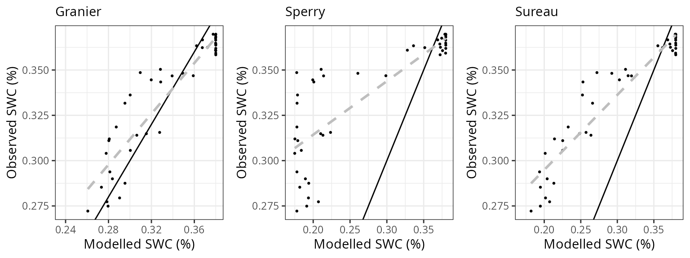

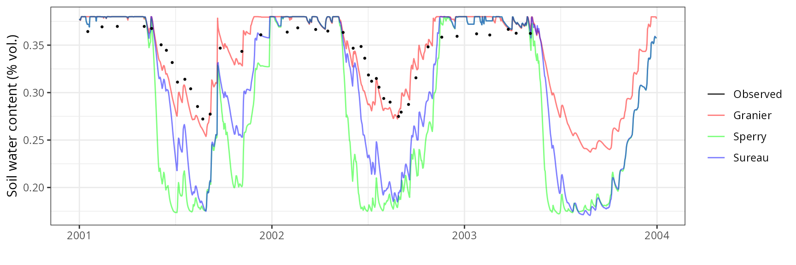

#### Soil water content (SWC.4)

| Site | Mode | n | Bias | Bias.rel | MAE | MAE.rel | r | NSE | NSE.abs |
|:---|:---|---:|---:|---:|---:|---:|---:|---:|---:|
| FRAHES | granier | 43 | -0.0181828 | -5.61103 | 0.0305763 | 9.435528 | 0.8245197 | -7.797841 | -2.083737 |
| FRAHES | sperry | 43 | -0.0800237 | -24.69446 | 0.0895263 | 27.626869 | 0.7023842 | -82.454268 | -8.029066 |
| FRAHES | sureau | 43 | -0.0596654 | -18.41211 | 0.0698058 | 21.541328 | 0.8405228 | -51.652192 | -6.040178 |

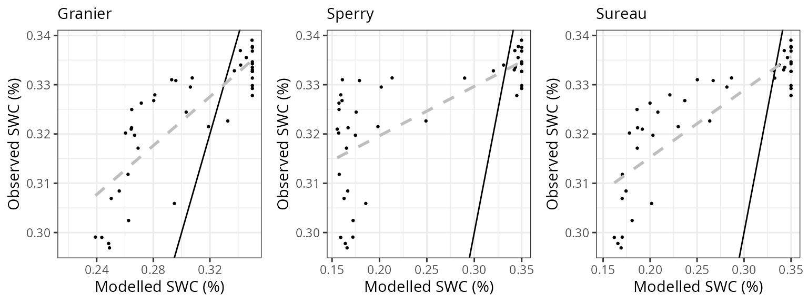

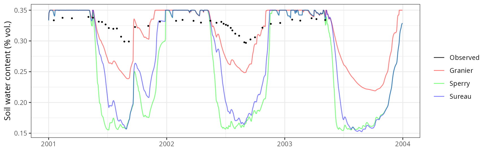

#### Soil water content (SWC.5)

| Site | Mode | n | Bias | Bias.rel | MAE | MAE.rel | r | NSE | NSE.abs |
|:---|:---|---:|---:|---:|---:|---:|---:|---:|---:|
| FRAHES | granier | 43 | -0.0068055 | -2.300378 | 0.0090345 | 3.053820 | 0.5126269 | -12.482725 | -2.782743 |
| FRAHES | sperry | 43 | -0.0042129 | -1.424030 | 0.0058803 | 1.987647 | 0.4514602 | -4.524014 | -1.462084 |
| FRAHES | sureau | 43 | -0.0049546 | -1.674744 | 0.0068244 | 2.306755 | 0.4403733 | -6.372462 | -1.857360 |

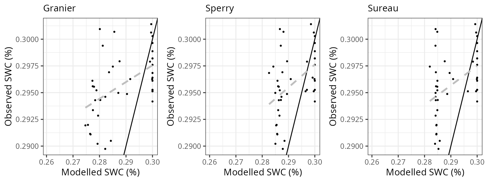

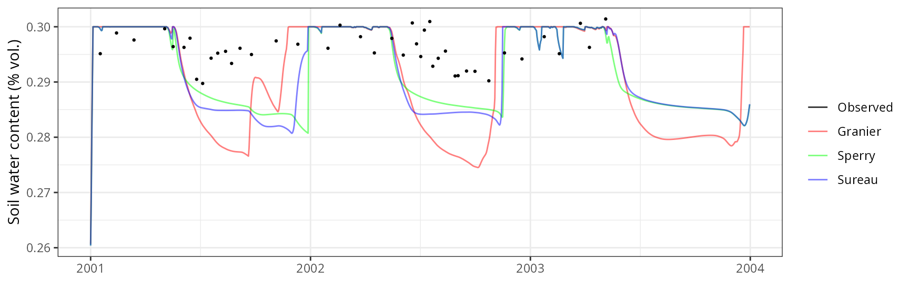

#### Transpiration per leaf area

| Site | Cohort | Mode | n | Bias | Bias.rel | MAE | MAE.rel | r | NSE | NSE.abs |
|:---|:---|:---|---:|---:|---:|---:|---:|---:|---:|---:|
| FRAHES | T1_1395 | granier | 559 | -0.2027990 | -40.085466 | 0.2689451 | 53.15998 | 0.8011775 | 0.1320789 | 0.1716450 |
| FRAHES | T1_1395 | sperry | 559 | -0.0278057 | -5.496101 | 0.2447624 | 48.38000 | 0.6569234 | 0.3618496 | 0.2461281 |
| FRAHES | T1_1395 | sureau | 559 | -0.0885053 | -17.494059 | 0.2058597 | 40.69045 | 0.7549163 | 0.4985803 | 0.3659490 |

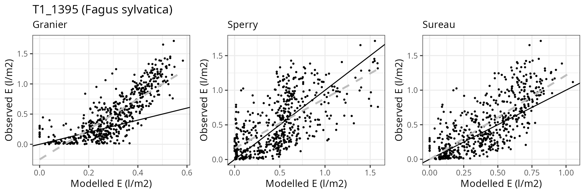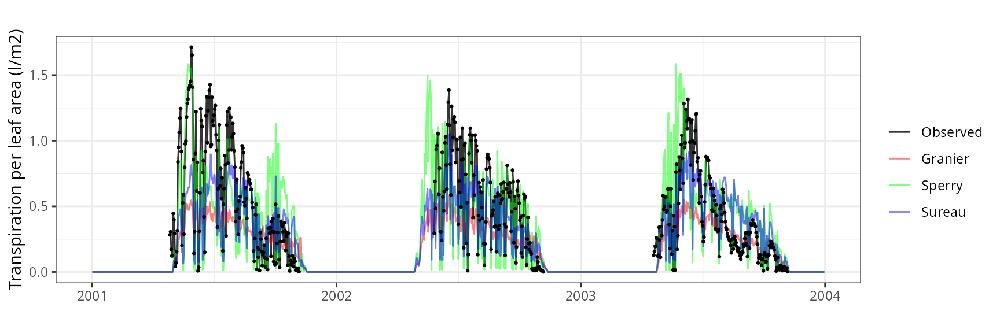

## Font-Blanche

### General information

| Attribute | Value |
|:---|:---|
| Plot name | Font-Blanche |
| Country | France |
| SAPFLUXNET code |  |
| SAPFLUXNET contributor (affiliation) |  |
| FLUXNET/ICOS code | FR-Fbn |
| FLUXNET/ICOS contributor (affiliation) | Nicolas Martin-StPaul (INRAE) |
| Latitude (º) | 43.24 |
| Longitude (º) | 5.68 |
| Elevation (m) | 420 |
| Slope (º) | 0 |
| Aspect (º) | 0 |
| Parent material | Cretaceous limestone |
| Soil texture | Clay loam |
| MAT (ºC) | 13.5 |
| MAP (mm) | 722 |
| Forest stand | Mixed forest with P. halepensis and Q. ilex |
| Stand LAI | 2 |
| Stand description DOI | 10.1016/j.agrformet.2021.108472 |
| Species simulated | Quercus ilex, Pinus halepensis, Phillyrea latifolia |
| Species parameter table | SpParamsFR |
| Simulation period | 2014-2018 |
| Evaluation period | 2014-2018 |

### Model inputs

#### Vegetation

| Species             |       DBH |    Height |    N | Z50 |  Z95 |       LAI | Cover |
|:--------------------|----------:|----------:|-----:|----:|-----:|----------:|------:|
| Phillyrea latifolia |  2.587859 |  323.0000 | 1248 | 200 | 1500 | 0.2238497 |    NA |
| Pinus halepensis    | 26.759914 | 1195.7667 |  256 | 200 |  800 | 1.0767397 |    NA |
| Quercus ilex        |  6.220031 |  495.5532 | 3104 | 300 | 2000 | 1.3994106 |    NA |
| Herbaceous layer    |        NA |   10.0000 |   NA |  NA |   NA |        NA |     5 |

#### Soil

| widths | clay | sand |  om |   bd | rfc |
|-------:|-----:|-----:|----:|-----:|----:|
|    300 |   39 |   26 |   6 | 1.45 |  50 |
|    700 |   39 |   26 |   3 | 1.45 |  65 |
|   1000 |   39 |   26 |   1 | 1.45 |  90 |
|   2500 |   39 |   26 |   1 | 1.45 |  95 |

#### Custom traits

| Species | GrowthForm | Hmax | Hmed | SLA | Kmax_stemxylem | LeafEPS | LeafPI0 | LeafAF | StemEPS | StemPI0 | StemAF | Al2As |
|:---|:---|---:|---:|---:|---:|---:|---:|---:|---:|---:|---:|---:|
| Phillyrea latifolia | Tree/Shrub | NA | NA | NA | NA | 12.38 | -2.13 | 0.5 | 12.38 | -2.13 | 0.4 | NA |
| Pinus halepensis | Tree | NA | NA | NA | 0.15 | 5.31 | -1.50 | 0.6 | 5.00 | -1.65 | 0.4 | 631.000 |
| Quercus ilex | Tree | 1240 | 450 | 4.55 | 0.40 | 15.00 | -2.50 | 0.4 | 15.00 | -2.50 | 0.4 | 1540.671 |

#### Custom control

||
||
||

#### Remarks

| Title      | Remark                        |
|:-----------|:------------------------------|
| Soil       | Equal to Puechabon            |
| Vegetation |                               |
| Weather    | Missing values for some dates |

### Macroclimate

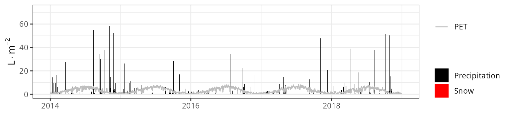

### Microclimate

### Runoff & deep drainage

### Evaluation results

#### Sensible heat turbulent flux

| Site | Mode | n | Bias | Bias.rel | MAE | MAE.rel | r | NSE | NSE.abs |
|:---|:---|---:|---:|---:|---:|---:|---:|---:|---:|
| FONBLA | sperry | 1004 | -2.647380 | -54.00666 | 4.179046 | 85.25272 | 0.6494219 | 0.0612005 | 0.0968037 |
| FONBLA | sureau | 1004 | -2.752923 | -56.15976 | 4.230436 | 86.30109 | 0.6405641 | 0.0350834 | 0.0856970 |

#### Latent heat turbulent flux

| Site | Mode | n | Bias | Bias.rel | MAE | MAE.rel | r | NSE | NSE.abs |
|:---|:---|---:|---:|---:|---:|---:|---:|---:|---:|
| FONBLA | sperry | 1026 | -0.6182866 | -21.08741 | 1.490807 | 50.84577 | 0.4709131 | -0.0635334 | 0.0143975 |
| FONBLA | sureau | 1026 | -0.5880806 | -20.05720 | 1.755006 | 59.85661 | 0.3279738 | -0.3886882 | -0.1602699 |

#### Soil water content (SWC)

| Site | Mode | n | Bias | Bias.rel | MAE | MAE.rel | r | NSE | NSE.abs |
|:---|:---|---:|---:|---:|---:|---:|---:|---:|---:|
| FONBLA | granier | 1760 | -0.1477678 | -33.15614 | 0.1477992 | 33.16317 | 0.9106894 | -0.3352652 | -0.1563538 |
| FONBLA | sperry | 1760 | -0.1454930 | -32.64571 | 0.1462775 | 32.82174 | 0.8941807 | -0.3594269 | -0.1444487 |
| FONBLA | sureau | 1760 | -0.1397354 | -31.35382 | 0.1409238 | 31.62047 | 0.8791511 | -0.2788332 | -0.1025622 |

#### Transpiration per leaf area

| Site | Cohort | Mode | n | Bias | Bias.rel | MAE | MAE.rel | r | NSE | NSE.abs |
|:---|:---|:---|---:|---:|---:|---:|---:|---:|---:|---:|
| FONBLA | T2_2851 | granier | 300 | 0.1541951 | 74.971499 | 0.1731620 | 84.19343 | 0.5507077 | -3.0829734 | -0.7498912 |
| FONBLA | T2_2851 | sperry | 300 | 0.0312223 | 15.180677 | 0.1234621 | 60.02874 | 0.3457555 | -1.1520577 | -0.2476481 |
| FONBLA | T2_2851 | sureau | 300 | 0.0077858 | 3.785546 | 0.1413387 | 68.72054 | 0.2052223 | -1.5554610 | -0.4283000 |
| FONBLA | T3_3094 | granier | 309 | 0.0053793 | 1.858406 | 0.0659809 | 22.79459 | 0.8714204 | 0.7529461 | 0.5504859 |
| FONBLA | T3_3094 | sperry | 309 | 0.1250562 | 43.203483 | 0.1806541 | 62.41101 | 0.7473737 | -0.7185427 | -0.2307581 |
| FONBLA | T3_3094 | sureau | 309 | 0.0511181 | 17.659882 | 0.1203943 | 41.59291 | 0.7944753 | 0.0100109 | 0.1797792 |

#### Leaf water potential

| Site | Cohort | WP | Mode | n | Bias | Bias.rel | MAE | MAE.rel | r | NSE | NSE.abs |
|:---|:---|:---|:---|---:|---:|---:|---:|---:|---:|---:|---:|
| FONBLA | T2_2851 | Midday | sperry | 3 | 1.4902646 | 55.86165 | 1.4902646 | 55.86165 | 0.9247263 | -43.3036657 | -6.9677515 |
| FONBLA | T2_2851 | Midday | sureau | 3 | 1.8407245 | 68.99842 | 1.8407245 | 68.99842 | 0.7930637 | -65.7988895 | -8.8414971 |
| FONBLA | T2_2851 | Predawn | sperry | 3 | 1.6704950 | 85.88663 | 1.6704950 | 85.88663 | 0.9532199 | -14.4585393 | -3.6982672 |
| FONBLA | T2_2851 | Predawn | sureau | 3 | 1.6985609 | 87.32961 | 1.6985609 | 87.32961 | 0.9132951 | -15.0418571 | -3.7772026 |
| FONBLA | T3_3094 | Midday | sperry | 3 | -0.4733308 | -17.34518 | 0.4733308 | 17.34518 | 0.9916006 | -0.8989851 | -0.4622347 |
| FONBLA | T3_3094 | Midday | sureau | 3 | 1.0199678 | 37.37667 | 1.0199678 | 37.37667 | 0.9228577 | -8.6299996 | -2.1509302 |
| FONBLA | T3_3094 | Predawn | sperry | 3 | -0.7899985 | -52.04968 | 0.7899985 | 52.04968 | 1.0000000 | -1.7998101 | -0.7849338 |
| FONBLA | T3_3094 | Predawn | sureau | 3 | 0.4432434 | 29.20344 | 0.5490569 | 36.17505 | 0.9533009 | -0.4212948 | -0.2405470 |

## Yatir

### General information

| Attribute | Value |
|:---|:---|
| Plot name | Yatir |
| Country | Israel |
| SAPFLUXNET code | ISR_YAT_YAT |
| SAPFLUXNET contributor (affiliation) | Fyodor Tatarinov (Weizmann Institute of Science) |
| FLUXNET/ICOS code | IL-Yat |
| FLUXNET/ICOS contributor (affiliation) | Dan Yakir (Weizmann Institute of Science) |
| Latitude (º) | 31.3449993133544 |
| Longitude (º) | 35.0514984130859 |
| Elevation (m) | 650 |
| Slope (º) | 0 |
| Aspect (º) | 0 |
| Parent material | Chalk and limestone |
| Soil texture | Clay loam |
| MAT (ºC) | 17.9 |
| MAP (mm) | 294 |
| Forest stand | Pinus halepensis managed plantation |
| Stand LAI | 1.5 |
| Stand description DOI | 10.1111/nph.13597 |
| Species simulated | Pinus halepensis |
| Species parameter table | SpParamsES |
| Simulation period | 2014-2015 |
| Evaluation period | 2014-2015 |

### Model inputs

#### Vegetation

| Species          |  DBH | Height |   N | Z50 |  Z95 | LAI |
|:-----------------|-----:|-------:|----:|----:|-----:|----:|
| Pinus halepensis | 19.8 |   1020 | 300 | 150 | 2000 | 1.7 |

#### Soil

| widths | sand | clay |  om |   bd | rfc | VG_theta_sat | VG_theta_res |
|-------:|-----:|-----:|----:|-----:|----:|-------------:|-------------:|
|     50 |   31 |   30 |   3 | 1.54 |   5 |         0.30 |         0.05 |
|    100 |   31 |   30 |   2 | 1.54 |   5 |         0.30 |         0.05 |
|    100 |   31 |   40 |   2 | 1.54 |  10 |         0.30 |         0.08 |
|    100 |   31 |   42 |   1 | 1.54 |  20 |         0.30 |         0.09 |
|    150 |   31 |   42 |   1 | 1.54 |  20 |         0.33 |         0.11 |
|    500 |   31 |   42 |   1 | 1.54 |  30 |         0.33 |         0.11 |
|   3000 |   31 |   42 |   0 | 1.54 |  90 |         0.33 |         0.11 |

#### Custom traits

| Species          | Kmax_stemxylem |
|:-----------------|---------------:|
| Pinus halepensis |           0.15 |

#### Custom control

||
||
||

#### Remarks

| Title | Remark |
|:---|:---|
| Soil | 50-cm soil with rocky layers. Modification of theta_res and theta_sat |
| Vegetation | No understory considered |
| Sapflow | Scaling done using stand density and stand LAI |

### Macroclimate

### Microclimate

### Runoff & deep drainage

### Evaluation results

#### Sensible heat turbulent flux

| Site | Mode | n | Bias | Bias.rel | MAE | MAE.rel | r | NSE | NSE.abs |
|:---|:---|---:|---:|---:|---:|---:|---:|---:|---:|
| ISRYAT | sperry | 365 | -4.254605 | -50.99171 | 4.679861 | 56.08843 | 0.6891379 | -0.2930627 | -0.0894626 |
| ISRYAT | sureau | 365 | -4.511890 | -54.07529 | 4.916934 | 58.92976 | 0.6584529 | -0.4324849 | -0.1446527 |

#### Latent heat turbulent flux

| Site | Mode | n | Bias | Bias.rel | MAE | MAE.rel | r | NSE | NSE.abs |
|:---|:---|---:|---:|---:|---:|---:|---:|---:|---:|
| ISRYAT | sperry | 365 | -0.8788734 | -40.19103 | 1.261291 | 57.67903 | 0.1782012 | -0.8103869 | -0.3438670 |
| ISRYAT | sureau | 365 | -0.5375392 | -24.58176 | 1.106279 | 50.59034 | 0.2526533 | -0.4905915 | -0.1787073 |

#### Gross primary productivity

| Site | Mode | n | Bias | Bias.rel | MAE | MAE.rel | r | NSE | NSE.abs |
|:---|:---|---:|---:|---:|---:|---:|---:|---:|---:|
| ISRYAT | granier | 365 | 0.7852077 | 39.87074 | 0.9546434 | 48.47423 | 0.7986507 | 0.2714493 | 0.2705153 |
| ISRYAT | sperry | 365 | 0.3967600 | 20.14641 | 1.1316269 | 57.46097 | 0.5857537 | 0.2635628 | 0.1352745 |
| ISRYAT | sureau | 365 | 0.9155601 | 46.48968 | 1.3632933 | 69.22437 | 0.5841474 | -0.0101899 | -0.0417520 |

#### Soil water content (SWC.3)

| Site | Mode | n | Bias | Bias.rel | MAE | MAE.rel | r | NSE | NSE.abs |
|:---|:---|---:|---:|---:|---:|---:|---:|---:|---:|
| ISRYAT | granier | 300 | 0.0654786 | 55.63602 | 0.0657311 | 55.85052 | 0.9232642 | -0.5728669 | -0.3761978 |
| ISRYAT | sperry | 300 | 0.0870181 | 73.93771 | 0.0872426 | 74.12843 | 0.8428786 | -1.7802831 | -0.8265788 |
| ISRYAT | sureau | 300 | 0.0697643 | 59.27742 | 0.0699810 | 59.46156 | 0.9092877 | -0.7521905 | -0.4651766 |

#### Soil water content (SWC.6)

| Site | Mode | n | Bias | Bias.rel | MAE | MAE.rel | r | NSE | NSE.abs |
|:---|:---|---:|---:|---:|---:|---:|---:|---:|---:|
| ISRYAT | granier | 300 | -0.0111614 | -4.702687 | 0.0198749 | 8.374000 | 0.8550025 | 0.6392384 | 0.3642076 |
| ISRYAT | sperry | 300 | 0.0044639 | 1.880796 | 0.0206214 | 8.688499 | 0.7579224 | 0.5456027 | 0.3403295 |
| ISRYAT | sureau | 300 | -0.0109288 | -4.604690 | 0.0240689 | 10.141056 | 0.8098069 | 0.4656420 | 0.2300447 |

#### Transpiration per leaf area

| Site | Cohort | Mode | n | Bias | Bias.rel | MAE | MAE.rel | r | NSE | NSE.abs |
|:---|:---|:---|---:|---:|---:|---:|---:|---:|---:|---:|
| ISRYAT | T1_358 | granier | 309 | -0.1293704 | -28.84138 | 0.1889870 | 42.13209 | 0.7138692 | 0.3538445 | 0.3064075 |
| ISRYAT | T1_358 | sperry | 309 | -0.2432924 | -54.23876 | 0.2513558 | 56.03639 | 0.4099058 | -0.4042978 | 0.0775103 |
| ISRYAT | T1_358 | sureau | 309 | -0.1433723 | -31.96293 | 0.2286875 | 50.98280 | 0.4347559 | -0.0224582 | 0.1607042 |

## Mitra

### General information

| Attribute | Value |
|:---|:---|
| Plot name | Mitra II |
| Country | Portugal |
| SAPFLUXNET code | PRT_MIT |
| SAPFLUXNET contributor (affiliation) | Teresa David (INIAV IP) |
| FLUXNET/ICOS code | PT-Mi1 |
| FLUXNET/ICOS contributor (affiliation) | Joao Santos Pereira |
| Latitude (º) | 38.54056 |
| Longitude (º) | -8.00028 |
| Elevation (m) | 235 |
| Slope (º) | 0 |
| Aspect (º) | 0 |
| Parent material | Granite |
| Soil texture | Sand |
| MAT (ºC) | 16.5 |
| MAP (mm) | 584 |
| Forest stand | Evergreen forest dominated by Quercus ilex subsp. rotundifolia |
| Stand LAI | 0.55 (trees) |
| Stand description DOI | 10.1093/treephys/27.6.793 |
| Species simulated | Quercus ilex |
| Species parameter table | SpParamsES |
| Simulation period | 2001-2003 |
| Evaluation period | 2001-2003 |

### Model inputs

#### Vegetation

| Species                |  DBH | Height |   N | Z50 |  Z95 |  LAI | Cover |
|:-----------------------|-----:|-------:|----:|----:|-----:|-----:|------:|
| Quercus ilex ssp. ilex | 38.9 |    750 |  30 | 529 | 2287 | 0.55 |    NA |
| Herbaceous layer       |   NA |     15 |  NA |  NA |   NA |   NA |   100 |

#### Soil

| widths |     clay | sand |   om |       bd |      rfc |
|-------:|---------:|-----:|-----:|---------:|---------:|
|    300 | 14.86667 | 58.4 | 2.92 | 1.463333 | 20.46667 |
|    700 | 15.05000 | 63.8 | 1.10 | 1.535000 | 21.65000 |
|   1000 | 14.70000 | 64.1 | 0.87 | 1.550000 | 80.00000 |
|   2000 | 14.70000 | 64.1 | 0.00 | 1.550000 | 90.00000 |

#### Custom traits

| Species                |    Al2As |
|:-----------------------|---------:|
| Quercus ilex ssp. ilex | 1540.671 |

#### Custom control

||
||
||

#### Remarks

| Title                | Remark                                  |
|:---------------------|:----------------------------------------|
| Soil                 | Taken from SoilGrids                    |
| Vegetation           | No understory but 100% herbaceous cover |
| Soil moisture data   | Not available                           |
| Eddy covariance data | Not enough quality for evaluation       |

### Macroclimate

### Microclimate

### Runoff & deep drainage

### Evaluation results

#### Transpiration per leaf area

| Site | Cohort | Mode | n | Bias | Bias.rel | MAE | MAE.rel | r | NSE | NSE.abs |
|:---|:---|:---|---:|---:|---:|---:|---:|---:|---:|---:|
| MITRA | T1_397 | granier | 1060 | -0.6207926 | -59.95775 | 0.6332131 | 61.15734 | 0.8473664 | -1.1440275 | -0.6813127 |
| MITRA | T1_397 | sperry | 1060 | -0.1918802 | -18.53228 | 0.2968685 | 28.67233 | 0.8986766 | 0.4070701 | 0.2117521 |
| MITRA | T1_397 | sureau | 1060 | -0.2839823 | -27.42774 | 0.4363361 | 42.14246 | 0.8325488 | -0.1404814 | -0.1585633 |

## Prades

### General information

| Attribute | Value |
|:---|:---|
| Plot name | Prades (Tillar valley) |
| Country | Spain |
| SAPFLUXNET code | ESP_TIL_MIX |
| SAPFLUXNET contributor (affiliation) | Rafael Poyatos (CREAF) |
| FLUXNET/ICOS code |  |
| FLUXNET/ICOS contributor (affiliation) |  |
| Latitude (º) | 41.33263 |
| Longitude (º) | 1.014429 |
| Elevation (m) | 1018 |
| Slope (º) | 35 |
| Aspect (º) | 8.53 |
| Parent material | Fractured schist |
| Soil texture | Clay loam |
| MAT (ºC) | 10.5 |
| MAP (mm) | 651.274727491089 |
| Forest stand | Mixed forest with P. sylvestris (overstory) Q. ilex (midstory) |
| Stand LAI | 3.27 |
| Stand description DOI | 10.1111/nph.12278 |
| Species simulated | Quercus ilex, Pinus sylvestris |
| Species parameter table | SpParamsES |
| Simulation period | 2010-2013 |
| Evaluation period | 2010-2013 |

### Model inputs

#### Vegetation

| Species                |  DBH | Height |    N | Z50 |  Z95 |  LAI | Cover |
|:-----------------------|-----:|-------:|-----:|----:|-----:|-----:|------:|
| Pinus sylvestris       | 27.7 |   1424 |  257 | 300 | 1200 | 0.58 |    NA |
| Quercus ilex ssp. ilex |  8.4 |    500 | 2913 | 529 | 2287 | 2.69 |    NA |
| Herbaceous layer       |   NA |     20 |   NA |  NA |   NA |   NA |    10 |

#### Soil

| widths | clay | sand |  om |  bd | rfc |
|-------:|-----:|-----:|----:|----:|----:|
|    300 |   21 |   47 |   4 | 1.5 |  45 |
|    700 |   19 |   48 |   4 | 1.5 |  70 |
|   1000 |   19 |   48 |   4 | 1.5 |  85 |
|   2500 |   19 |   48 |   4 | 1.5 |  90 |

#### Custom traits

| Species                |     Al2As |
|:-----------------------|----------:|
| Pinus sylvestris       |  594.5372 |
| Quercus ilex spp. ilex | 1387.0312 |

#### Custom control

||
||
||

#### Remarks

| Title      | Remark                                      |
|:-----------|:--------------------------------------------|
| Soil       | Additional rocky layer considered           |
| Vegetation | Understory not considered                   |
| Sapflow    | No scaling required (already per leaf area) |

### Macroclimate

### Microclimate

### Runoff & deep drainage

### Evaluation results

#### Soil water content (SWC)

| Site | Mode | n | Bias | Bias.rel | MAE | MAE.rel | r | NSE | NSE.abs |
|:---|:---|---:|---:|---:|---:|---:|---:|---:|---:|
| PRADES | granier | 1219 | 0.0199586 | 10.475019 | 0.0301835 | 15.84142 | 0.9303086 | 0.7599263 | 0.4947706 |
| PRADES | sperry | 1219 | 0.0148339 | 7.785388 | 0.0312449 | 16.39851 | 0.8838056 | 0.7359234 | 0.4770035 |
| PRADES | sureau | 1219 | 0.0065667 | 3.446423 | 0.0226402 | 11.88242 | 0.9208780 | 0.8381908 | 0.6210347 |

#### Transpiration per leaf area

| Site | Cohort | Mode | n | Bias | Bias.rel | MAE | MAE.rel | r | NSE | NSE.abs |
|:---|:---|:---|---:|---:|---:|---:|---:|---:|---:|---:|
| PRADES | T1_363 | granier | 1157 | -0.0043746 | -1.665938 | 0.1270240 | 48.37381 | 0.7302004 | 0.4656068 | 0.3522200 |
| PRADES | T1_363 | sperry | 1157 | 0.0421311 | 16.044542 | 0.1432898 | 54.56820 | 0.7415870 | 0.4591805 | 0.2692701 |
| PRADES | T1_363 | sureau | 1157 | 0.0361113 | 13.752047 | 0.1359713 | 51.78116 | 0.7675229 | 0.3541442 | 0.3065917 |
| PRADES | T2_397 | granier | 908 | 0.0721493 | 43.603566 | 0.0931496 | 56.29516 | 0.8183491 | -0.0170765 | 0.0808354 |
| PRADES | T2_397 | sperry | 908 | 0.0914808 | 55.286598 | 0.1396746 | 84.41263 | 0.6229719 | -2.3696833 | -0.3782553 |
| PRADES | T2_397 | sureau | 908 | 0.1190648 | 71.957031 | 0.1538703 | 92.99183 | 0.7275772 | -2.3070224 | -0.5183331 |

#### Leaf water potential

| Site | Cohort | WP | Mode | n | Bias | Bias.rel | MAE | MAE.rel | r | NSE | NSE.abs |
|:---|:---|:---|:---|---:|---:|---:|---:|---:|---:|---:|---:|
| PRADES | T1_363 | Midday | sperry | 13 | 0.5885578 | 34.340919 | 0.5885578 | 34.34092 | 0.9121766 | -2.6417276 | -1.5323753 |
| PRADES | T1_363 | Midday | sureau | 13 | 0.0888753 | 5.185659 | 0.3949806 | 23.04616 | 0.9029029 | -1.3152136 | -0.6994745 |
| PRADES | T1_363 | Predawn | sperry | 13 | 0.4692731 | 39.229585 | 0.4692731 | 39.22959 | 0.9613028 | -0.3288866 | -0.3254942 |
| PRADES | T1_363 | Predawn | sureau | 13 | -0.1631710 | -13.640521 | 0.4898085 | 40.94627 | 0.9320368 | -0.4516470 | -0.3834978 |
| PRADES | T2_397 | Midday | sperry | 9 | 0.1122334 | 3.898389 | 1.5159695 | 52.65669 | 0.3250149 | -1.6220804 | -0.7821531 |
| PRADES | T2_397 | Midday | sureau | 9 | 0.8945900 | 31.073284 | 1.1700434 | 40.64106 | 0.9454767 | -0.4202776 | -0.3754870 |
| PRADES | T2_397 | Predawn | sperry | 9 | 0.2126902 | 10.068083 | 1.9255653 | 91.15016 | 0.2119137 | -2.5439148 | -1.1179864 |
| PRADES | T2_397 | Predawn | sureau | 9 | 0.3476729 | 16.457734 | 0.9446796 | 44.71814 | 0.9387045 | 0.2572971 | -0.0390811 |

